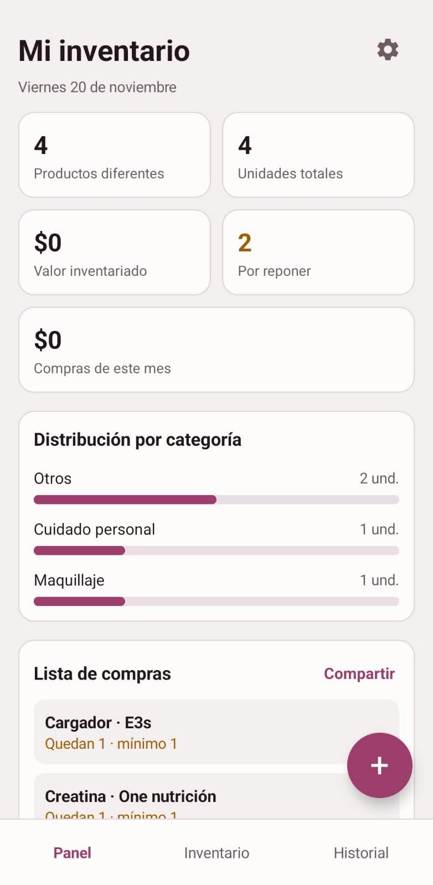
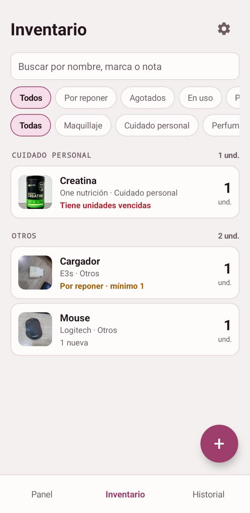
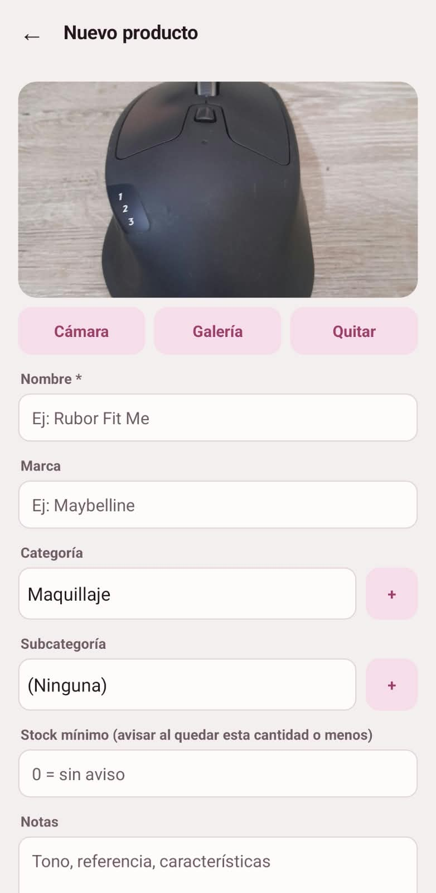
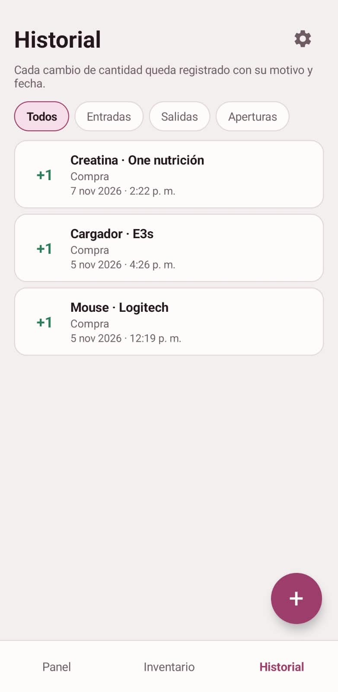
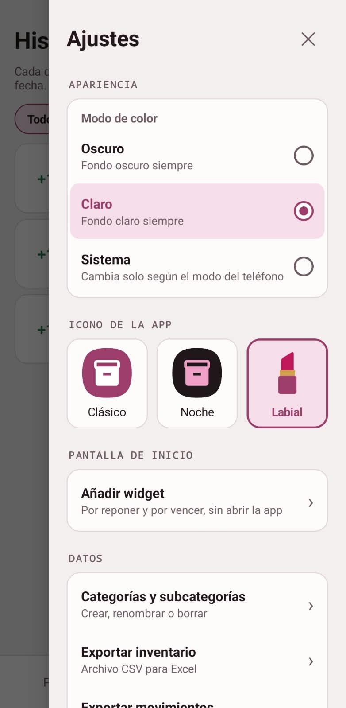

# Mi Inventario

App Android para llevar el inventario personal: maquillaje, cuidado personal, ropa, accesorios
o lo que se quiera organizar. Avisa cuando algo se está acabando o está por vencer y guarda el
historial de cada entrada y salida. Todo queda en el teléfono; no necesita cuenta ni internet.

Escrita en Kotlin con el SDK de Android, sin librerías externas.

<p>
  
  
  
  
  
</p>

## Qué hace

- **Productos con foto**, marca, notas, categoría y subcategoría. La foto se toma con la cámara
  o se elige de la galería.
- **Lotes** con precio y fecha de vencimiento: cada compra entra como un lote propio.
- **Entradas, salidas y aperturas** con su motivo (compra, regalo, se terminó, dañado, vencido…)
  y un historial filtrable de todos los movimientos.
- **Panel** con productos, unidades, valor inventariado, compras del mes y distribución por
  categoría.
- **Lista de compras** con lo que llegó a su stock mínimo, lista para compartir.
- **Alertas**: una notificación cuando hay productos por reponer, agotados, por vencer o vencidos.
- **Widget** para la pantalla de inicio con lo urgente, sin abrir la app.
- **Exportación a CSV** del inventario y de los movimientos, en un formato que Excel en español
  abre con columnas y tildes correctas.
- **Apariencia**: modo claro, oscuro o el del teléfono, y tres iconos para elegir.

## Cómo está hecha

| | |
|---|---|
| Lenguaje | Kotlin 2.0 |
| Android | mínimo 9 (API 28), compilada para Android 15 (API 35) |
| Interfaz | vistas nativas construidas en código, sin XML de pantallas ni Compose |
| Datos | SQLite con `SQLiteOpenHelper`: categorías, productos, lotes y movimientos |
| Alertas | `JobScheduler`, revisión cada 12 horas y al reiniciar el teléfono |
| Dependencias | ninguna fuera del SDK de Android |
| Tamaño | unas 2.600 líneas en 12 archivos |

El código está en `app/src/main/java/com/davidagb/inventario/`:

| Archivo | Qué contiene |
|---|---|
| `Data.kt` | Modelo, base de datos y reglas del inventario (lotes, salidas, aperturas) |
| `MainActivity.kt` | Panel, listado e historial |
| `ProductActivity.kt`, `EditProductActivity.kt` | Detalle y edición de un producto |
| `CategoriesActivity.kt` | Categorías y subcategorías |
| `Ui.kt`, `Theme.kt` | Componentes de la interfaz y colores |
| `Photos.kt` | Fotos y miniaturas |
| `Alerts.kt`, `Widget.kt` | Notificaciones y widget |
| `Export.kt` | Exportación a CSV |
| `SettingsDrawer.kt` | Panel de ajustes |

## Compilar

Con el SDK de Android instalado y Java 17:

```bash
./gradlew assembleDebug
```

El instalable queda en `app/build/outputs/apk/debug/`.

## Autor

**David Albarrán** · [@DavidAGB](https://github.com/DavidAGB)
